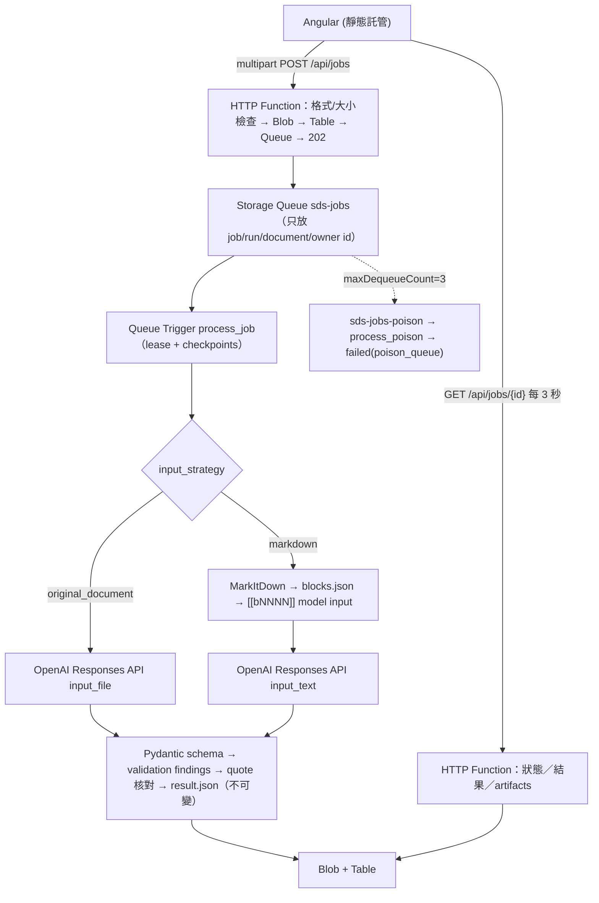

# 架構說明

## 流程

HTTP 函式回傳後不啟動任何 thread／asyncio task；所有耗時工作在 Queue Trigger 內同步執行（Python worker 以 thread pool 執行同步函式，不阻塞事件迴圈）。

## 目錄

| 路徑 | 內容 |
| --- | --- |
| `backend/function_app.py` | HTTP routes（薄層）、`process_job`、`process_poison` |
| `backend/domain/` | `models.py`（Job/Run/Stage 狀態機）、`extraction_schema.py`（pilot-v1 + strict JSON Schema）、`validation.py`（CAS／H／P／濃度／閃火點規則）、`errors.py` |
| `backend/services/` | `jobs.py`（上傳、idempotency、入列、retry、reconcile）、`pipeline.py`（lease、checkpoint、stage）、`extraction.py`（呼叫預算與重試）、`locator.py`（區塊 ID／offset／quote 核對）、`document_check.py`、`cost.py`、`scoring.py`、`experiments.py`、`review.py`、`auth.py`、`config.py`、`container.py` |
| `backend/adapters/` | `storage_azure.py`／`storage_memory.py`、`markitdown_adapter.py`、`openai_adapter.py`、`mock_provider.py`、`ocr_interface.py`（階段 6） |
| `backend/prompts/extraction_v1.md` | 版本化抽取指令（含 prompt-injection 防護敘述） |
| `contracts/` | JSON Schema（pilot-v1）、OpenAPI、gold schema、匯出格式 |
| `evaluation/` | `cli.py`（manifest／inspect／gold-template／submit／score）、`pricing.json`、`experiments/pilot-v1.json` |
| `infra/` | Bicep、參數範例、部署說明、Azurite compose |
| `frontend/` | Angular 22（zoneless、signals、standalone）四個頁面（上傳、任務列表、任務詳情、A/B/C/D 比較） |

## 儲存配置

- Blob 容器 `sds`：
  - `documents/{document_id}/original.{pdf|docx}`、`check.json`、`textlayer.json`
  - `documents/{document_id}/markdown/{converter_version}/content.md`、`blocks.json`（同文件、同轉換器版本可重用）
  - `jobs/{job_id}/runs/{run_id}/model-input.txt`（或原始策略的指標 JSON）、`model-response-{n}.json`（每次嘗試，含錯誤）、`extraction-raw.json`、`validation.json`、`result.json`（不可變）、`reviews/vNNNN.json`
- Table：`sdsdocuments`、`sdsjobs`（RowKey 反向時間戳，列表最新在前）、`sdsruns`（ETag 條件更新作 lease）、`sdsidempotency`、`sdsreviews`
- Queue：`sds-jobs`、`sds-jobs-poison`；訊息只含定位資料

每個 run 保存 `RunConfigSnapshot`：arm、策略、模型、provider、是否測試替身、prompt／schema／converter 版本、PDF detail、max_output_tokens、timeout、max_attempts、價格表版本、空白正規化版本，以及 model input 的 SHA-256。

## 狀態機

`enqueue_pending → queued → processing → succeeded | needs_review | failed`

- 入列失敗停在 `enqueue_pending`，由相同 Idempotency-Key 重送或 `POST /internal/reconcile` 補送。
- 暫時性錯誤（429／5xx／逾時／schema 連續錯誤前）：run 回到 `queued` 並重新拋出例外，由 Queue 重投遞（`maxDequeueCount=3`）；完成的 checkpoint 保留。
- lease：`processing` 且 `lease_expires_at` 未過期的重複訊息會被丟棄；過期可被接手（記錄 `lease_taken_over_from`）；reconcile 亦會重送過期 lease。
- 永久性錯誤（不支援格式、加密、損毀、需 OCR、模型拒絕、輸出截斷、候選模型不接受檔案）→ `failed`，不重試，絕不回傳空資料當成功。
- Poison queue → `failed(poison_queue)`。

**不保證 exactly-once**：API 回應成功但保存前中斷時，重試會再呼叫一次並產生費用；所有嘗試（含失敗）皆記錄於 `model_calls`。

## 時間預算

| 項目 | 值 |
| --- | --- |
| `functionTimeout` | 10 分鐘（host.json） |
| 處理 lease | 600 秒，每個 stage 完成時續約 |
| 單次模型呼叫 deadline | `OPENAI_TIMEOUT_SECONDS`（180） |
| 單次 invocation 模型呼叫 | `OPENAI_MAX_ATTEMPTS`（2，含第一次）；SDK `max_retries=0` |
| Retry-After | 尊重，但上限 30 秒並受剩餘預算限制 |
| 模型階段總預算 | lease − 已用時間 − 30 秒 |

## 來源定位

- Markdown 策略：`segment_markdown` 依空行／表格／標題切塊並記錄原始 offset，`build_model_input` 只在每塊前加 `[[bNNNN]]` 一行。模型回傳的 `block_id`／`quote` 以 `ws-v1` 空白正規化核對：verified／verified_elsewhere／not_found／unverifiable。
- 原始文件策略：PDF 用 pypdf 文字層逐頁核對（`page` 可驗證），DOCX 用 document.xml 文字核對；無法核對標 unverified。
- 絕不刪除數字、符號、單位後宣稱一致。
