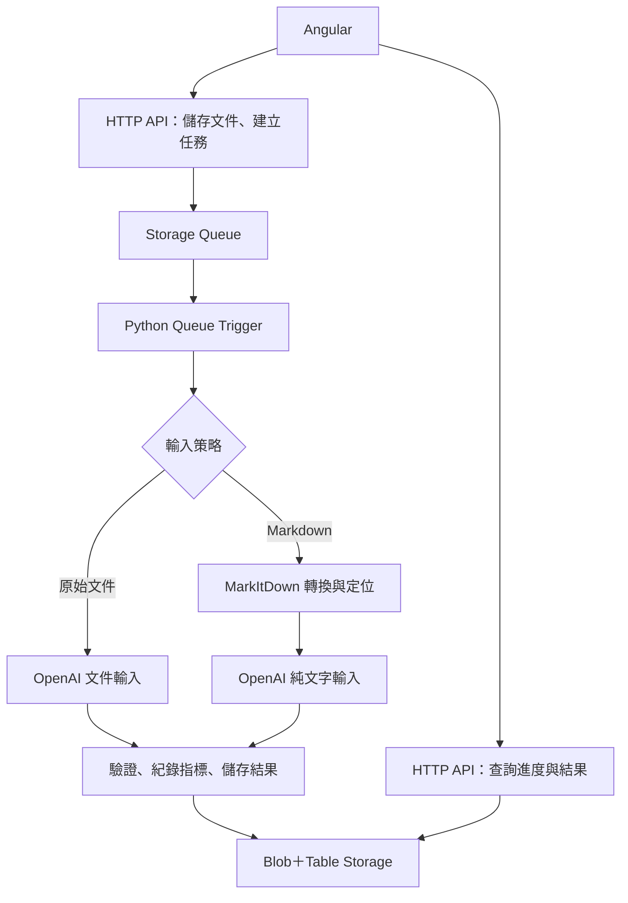

# SDS 文件解析 POC：Codex 開發規劃

版本：1.0｜日期：2026-10-03｜語言：繁體中文（台灣）

## 1. 任務與已確認決策

建立可執行的 SDS（安全資料表）解析 POC，比較「原始文件直接交給 OpenAI」與「先透過 MarkItDown 轉換文字，再交給 OpenAI」的差異。

已確認需求：

- 前端採 Angular，後端採 Python Azure Functions。
- MarkItDown 為主要文件轉換工具。
- OpenAI 為欄位抽取模型服務；初始採 OpenAI API，不自行改成 Azure OpenAI。
- Azure Functions 採 Flex Consumption；文件解析由 Azure Storage Queue Trigger 執行。
- HTTP API 上傳、建立任務後回傳任務 ID；前端以短請求輪詢進度。
- 現行約 85% 是「欄位正確率」，不是文件成功率；尚未取得原始測試集與完整評分定義。
- 比較欄位正確率、關鍵欄位錯誤、Token、總成本、處理耗時與失敗重試。
- 保留原始文件、轉換文字、模型原始輸出、驗證結果及人工修正，供追查。
- 使用者已有可測試的 PDF 與 Word 文件；不建立或交付範例 SDS。實際 Word 格式在開發時檢查，第一階段以 DOCX 為主。

未經實測的假設：轉換可能提高正確率、減少 PDF 影像 Token，並使較低成本模型可用。這些是驗證假設，不是保證。

## 2. Codex 執行原則

請依本文件實作專案，不要只產生架構說明。每個階段完成後進行適當驗證，最後提供啟動命令、已完成項目、測試結果與尚未驗證項目。

1. 先讀取既有 repository 與 AGENTS.md，沿用適用規範及既有程式，避免覆寫無關內容。
2. 空專案依第 12 節建立結構；已有專案則合理對應，不必機械重建。
3. 實作前核對官方 Angular、Azure Functions、MarkItDown 與 OpenAI 文件；固定可部署且相容的版本及 lockfile。
4. 建議 Python 3.12，Angular 採當時支援的穩定版本及相容 Node.js；記錄實際採用版本，不引用未驗證的 API。
5. 模型名稱由環境變數提供，不臆測現行模型或以程式預設偷偷替換。
6. 缺少金鑰時，以測試替身驗證程式與真實 provider 介面；明確標示哪些流程尚未實際呼叫。真實成效只能用使用者文件與實際 API 計算。
7. 本文件授權產生程式、設定範本、部署文件及測試。不要自動建立付費雲端資源、執行真實付費批次或發布服務。
8. 不產生範例 PDF、Word、合成 SDS 或預填假成效。以 TEST_SDS_DIR 指定使用者現有文件目錄；未設定或無文件時標記真實文件驗證尚未執行。
9. 日常實作選擇自行完成並記錄；缺失的業務欄位清單以版本化 pilot schema 處理，不自行宣稱重現既有 85%。

## 3. 第一階段範圍

### 必須完成

- DOCX 與具有可抽取文字的 PDF 上傳與格式檢查。
- 原始文件、MarkItDown 全文兩種輸入策略。
- 現行模型與候選較低成本模型兩種設定，形成 A/B/C/D 實驗組。
- 背景任務、任務狀態、原始 JSON 下載、人工修正與 CSV 評估匯出。
- Schema 約束輸出、程式驗證、來源片段、計時與 Token 紀錄。
- 使用現有文件的解析流程、可注入測試替身，以及具備設定後可執行的真實 OpenAI adapter。
- 本機 Angular、Functions Core Tools、Azurite 的啟動說明。
- Azure Flex Consumption 的部署範本與操作說明，不自動部署。

### 保留介面，第二階段實作

- Azure Document Intelligence Layout 的 OCR／版面處理。
- 只針對失敗頁面或章節使用 OCR／視覺模型的回退流程。
- 依 SDS 章節裁切、清除重複頁首頁尾，以及長文件分段抽取。
- 完整 16 章節的擴充欄位。

### 第一階段排除

- 舊式 DOC 自動轉換；收到 DOC 回傳明確的不支援格式訊息。
- 自動用 PubChem 或模型常識補足 SDS 缺失資訊。
- RAG、向量資料庫、fine-tuning 與自主 agent。
- 化學品法規合規判定、現場應變建議或安全決策。

掃描 PDF、空文字頁、加密 PDF、超過大小限制、破損文件不可靜默通過。初期分類為需 OCR、需核對或不支援；保留可理解的錯誤原因。具少量文字的掃描頁可能無法被完全偵測，須記錄這項限制。

## 4. 架構與儲存



### 元件

| 元件 | 用途 |
| --- | --- |
| Angular | 上傳、任務列表、原文／轉換文字／抽取欄位比較、修正、實驗摘要 |
| Python Function App | HTTP routes、Queue Trigger、provider adapters、驗證 |
| Blob Storage | 原始文件、原始 Markdown、model input、模型回應、版本化結果、評估檔 |
| Table Storage | 任務、文件、執行紀錄、階段狀態與輕量索引 |
| Storage Queue | 僅傳文件／任務／run ID 等定位資料，不傳整份文件或 Markdown |
| Application Insights | 階段耗時、錯誤種類、API request ID、重試與執行觀測 |

路徑以 UUID 與版本組成，原始檔名只作 metadata，不作儲存路徑。建議 Blob prefix：documents/{document_id}/、jobs/{job_id}/runs/{run_id}/。

每個 run 應保存 document SHA-256、model ID、prompt/schema/converter version、input strategy、設定快照；相同文件可重用轉檔，但實驗組的模型回應需各自紀錄。

前端由 Angular 支援的靜態託管方式部署，提供 Azure Static Web Apps 操作說明；瀏覽器呼叫獨立 Function App API，不使用 Static Web Apps managed API 取代此架構。

## 5. 處理流程與逾時

### 5.1 上傳與入列

1. 驗證格式、大小、權限，將文件寫入 Blob。
2. 建立 job/run 紀錄，狀態先標記 enqueue_pending。
3. 寫入 Queue 成功後，改為 queued，回傳 HTTP 202 及 status URL。
4. 若入列失敗，回傳可重試錯誤並保留可恢復紀錄；使用 Idempotency-Key 避免前端重送建立重複任務。
5. 同一使用者、相同 key、相同 payload 回傳原任務；相同 key 搭配不同 payload 回傳 409。
6. Table 與 Queue 寫入不是同一筆交易。提供恢復 enqueue_pending 任務的內部操作或 reconciliation 流程，測試部分成功後重送的行為。

### 5.2 背景解析

1. 以 run ID 檢查完成狀態與取得有期限的處理 lease，使用 ETag／條件更新防止重複處理。
2. 執行格式與內容品質檢查，記錄每頁文字量／PDF 頁數等可取得資訊。
3. 依策略送原始文件，或執行 MarkItDown 並保存原始 Markdown。
4. 建立實際 model input，保存輸入 SHA-256；不得默默截斷過長文件。
5. 呼叫 OpenAI、保存原始回應、usage 與 request ID。
6. 驗證 Schema、來源與欄位規則，保存不可變更的抽取結果。
7. 更新 succeeded 或 needs_review；服務失敗為 failed，禁止把解析失敗轉為成功的空資料。

完成 checkpoint 的階段在重試時重用。若外部 API 已完成，但程序在保存前中斷，可能仍產生重複呼叫與費用；不要宣稱 exactly-once 或完全避免重複扣費。

### 5.3 暫定設定

| 設定 | POC 起始值 | 性質 |
| --- | --- | --- |
| 文件大小上限 | 20 MiB | 工程起始值，可配置 |
| functionTimeout | 10 分鐘 | 整個 Function invocation 的執行預算 |
| 模型呼叫 application deadline | 每次 180 秒 | 起始預算，需涵蓋 SDK 實際行為與取消 |
| 單次 invocation 的模型呼叫 | 最多 2 次 | 包含第一次； SDK 自動重試停用，避免雙層重試失控 |
| Queue maxDequeueCount | 3 | 包含第一次；僅未完成階段重試 |
| 重試間隔 | 起始 30 秒，必要時退避 | 不代表函式執行逾時設定 |
| 前端輪詢 | 每 3 秒 | 可見頁面輪詢；離開頁面停止 |
| 每個執行個體的解析並行 | 起始 1 份 | 需同步限制 scale-out 或另設總量限制 |

上述數值是可調整設定，不是效能預測。180 秒不是 OpenAI 官方限制。耗時長的模型需依觀測值調整預算。單次等待、重試、轉檔及驗證的總和須留在 10 分鐘預算內。

230 秒是 HTTP 回應限制；Queue Trigger 不受這個 HTTP 回應限制，但仍受 functionTimeout 約束。Flex Consumption 預設為 30 分鐘，本 POC 主動設為 10 分鐘。即使取消固定上限，平台仍可能中斷執行。

不可用 HTTP 函式內的 asyncio.create_task()、背景 thread，或僅改成 async/await 取代 Queue Trigger。若 API adapter 為同步呼叫，亦不得阻塞需要同時工作的事件迴圈。

對 429、暫時性 5xx、網路中斷採有限重試並尊重 Retry-After；對格式不支援、無權限、加密文件等永久錯誤不重試。Poison queue handler 應將任務標記 failed 並保存原因。程序逾時也應能在 lease 到期後恢復，不得永久停留在 processing。

## 6. 抽取欄位與資料模型

### 6.1 Pilot 欄位

既有業務欄位清單未提供，因此先建立以下 pilot schema。schema 一旦用於評估便固定版本；後續取得既有欄位再新增版本及對照表。

| 群組 | 初期欄位 | 主要來源 |
| --- | --- | --- |
| 文件基本資料 | 產品名稱、SDS 修訂日期、供應商名稱 | 通常第 1、16 節，依文件實際內容 |
| 成分資料 | 各成分名稱、CAS No.、含量原文、含量單位／基準 | 通常第 3 節 |
| 危害資料 | 危害分類、警示語、H codes、P codes | 通常第 2 節 |
| 物性資料 | 閃火點原文、數值／範圍／比較符號、單位、測試條件 | 通常第 9 節 |

產品可能是混合物，不建立必填且唯一的產品 CAS No.。CAS 屬於成分列；成分名稱、CAS、濃度必須保持配對。若有多個 CAS，使用陣列並保留原文關係。

### 6.2 欄位 envelope

各欄位至少具有 value、raw_text、status、evidence。status 使用 found、not_reported、no_data、not_applicable、unreadable、conflict；value 可為 null。數字正規化必須保留原始值；不可把小於、範圍或未記載改為單一確定數值。

來源 evidence 型別包含 section、page、block_id、quote；未知定位填 null。建立完整型別契約即可，不額外提供範例 SDS 或示範資料。

實作時用 Pydantic 建立完整型別並產生 JSON Schema。成分為 Ingredient 陣列，危害分類／H/P codes 為陣列，閃火點為可表達 comparator、min、max、unit、conditions 的型別。確認 Schema 符合所選模型 Structured Outputs 的支援子集，不直接假設任何 Pydantic schema 都可傳入。

模型自述的 confidence 不作自動通過依據。系統依文件品質、來源存在、欄位規則與矛盾情形產生 validation findings。

### 6.3 來源定位

- PDF：保留頁數與可用文字區塊。MarkItDown 全文輸出若沒有可驗證頁面對應，page 填 null，不讓模型猜頁碼。
- DOCX：使用章節／段落／表格區塊 ID，不猜測未渲染的 Word 頁碼。
- Markdown 模式：為送入模型的區塊建立穩定 ID，保存與原始 Markdown 的 offset 對照。首次 A/B 測試只加入必要定位，不改寫內容或重新排序。
- 原始文件模式：允許來源定位為 null，但保留模型引用。PDF 可與獨立抽取的文字層核對，無法核對時標記 unverified，不假定真實。
- 後端核對 quote 是否存在於可驗證來源，先做有版本的空白正規化；不可任意刪除數字、符號與單位後宣稱一致。

### 6.4 驗證規則

1. JSON Schema 通過與內容正確分開紀錄。
2. CAS 格式與檢查碼；檢查碼正確不代表屬於該成分。
3. 成分列名稱、CAS 與濃度配對；人工 gold set 決定正確與否，不能只用號碼格式評分。
4. H/P code 先檢查格式；文件未明列代碼時不從敘述自行推導代碼。
5. 濃度保留百分比、範圍、比較符號及 w/w 等基準。不要因各濃度上限總和超過 100% 就直接判定錯誤。
6. 閃火點保留 °C／°F、比較符號與測試條件；無資料與不適用分開。
7. 無來源、來源矛盾、表格配對不確定時標記 needs_review，不編造資訊。
8. 提示詞明確要求將 SDS 內容視為待抽取資料，忽略文件中要求改變系統行為的指令。

## 7. API 與狀態

API prefix：/api。錯誤格式至少為 code、message、request_id，HTTP 狀態碼一致使用。

| 方法與路徑 | 功能與回傳 |
| --- | --- |
| POST /jobs | multipart 文件＋允許的 experiment arm；建立任務，202 回傳 job_id/run_id/status_url |
| GET /jobs | 使用者自己的任務列表，支援游標分頁與狀態過濾 |
| GET /jobs/{job_id} | status、stage、timestamps、warnings、stage elapsed、最新 run |
| GET /jobs/{job_id}/runs/{run_id}/result | 抽取結果、驗證 findings、usage、模型資訊；尚未就緒回傳可區別狀態 |
| GET /jobs/{job_id}/runs/{run_id}/artifacts/{kind} | 下載授權的 original/markdown/model-input/result；kind 為白名單 |
| PATCH /jobs/{job_id}/runs/{run_id}/review | 用 expected_review_version 儲存修正；保留原始結果及修正歷史 |
| POST /jobs/{job_id}/retry | 只對 failed/needs_review run 建立新 run；限制重試次數與權限 |
| GET /experiments/{experiment_id}/summary | 僅真實文件與真實 API 的評估摘要、有效樣本數、失敗數與指標 |
| GET /experiments/{experiment_id}/export | 匯出原始評估明細與 CSV；防止試算表公式注入 |

第一階段的 experiment 定義來自版本化設定／批次 CLI，不必建立完整管理後台。前端仍可顯示批次結果。

狀態：enqueue_pending → queued → processing → succeeded／needs_review／failed。

stage：validate_document、convert、extract、validate_result、persist。原始文件模式跳過 convert，但會記錄 skipped。有多階段時顯示階段，不產生沒有依據的精確完成百分比。

retry 建立新 run，保留前一 run、原因與所有 metrics。人工修正不改寫原始模型答案，也不自動成為 gold answer。

## 8. Angular 頁面

1. 上傳頁：PDF/DOCX、格式與大小限制、允許的實驗組、上傳結果與任務連結。
2. 任務列表：檔名、策略、模型、狀態、建立時間與處理時間。
3. 任務詳情：原始 PDF 預覽或 DOCX 下載、Markdown 文字、結構化欄位、來源片段、驗證警示。
4. 人工核對：編輯欄位及成分列，保存修正版本；清楚標示機器抽取與人工修正。
5. 比較頁：同一文件 A/B/C/D 結果、正確率、Token、總模型費用、各階段耗時；缺少 gold 時顯示未評分。

前端不得取得 OpenAI key、Storage connection string 或 Function master key。下載與結果 API 必須檢查文件所有權。Markdown 顯示使用 HTML sanitization，禁止 script 與未授權的遠端資源自動載入。

測試替身只供自動化測試與錯誤情境驗證；若開發模式顯示替身回應，標示「測試替身，未呼叫真實模型」，排除於成效統計。API 欄位以英文命名，介面與錯誤訊息以繁體中文呈現。

## 9. 比較實驗與評分

### 9.1 實驗組

| 組別 | 輸入 | 模型 | 目的 |
| --- | --- | --- | --- |
| A | 原始 PDF／DOCX | 現行模型 | 重現現行 API 流程的基準 |
| B | MarkItDown 全文 | 與 A 相同 | 單獨測量前處理效果 |
| C | 原始 PDF／DOCX | 候選較低成本模型 | 單獨測量模型差異 |
| D | MarkItDown 全文 | 與 C 相同 | 測量組合效果 |

所有組固定目標欄位、schema、抽取指令、輸出上限與可共同使用的模型參數。不同模型不支援的參數不可硬套，差異寫入設定快照。若候選模型不支援檔案輸入，C 標記 unsupported；不得偷偷換成文字後仍稱為原始文件組。

原始文件組使用 Responses API 的 input_file；Markdown 組使用 input_text。固定 PDF detail 設定並記錄。DOCX 與 PDF 必須分層呈現，因官方文件指出 PDF 包含文字及頁面影像，DOCX 主要抽取文字。

使用者既有 API、模型、欄位與提示詞未提供時，A 是「新的直接文件基準」，不可稱為已成功重現 85%。

初期不開章節裁切、頁首頁尾清除、OCR 外掛或局部視覺回退，以免 A/B 同時改變太多因素。第二階段將這些改良各自編成新 arm，不覆蓋 B/D。

### 9.2 測試集

- 從 TEST_SDS_DIR 或使用者上傳載入現有 PDF／Word；不產生測試用 SDS 文件。批次先列出格式、頁數／大小及可處理性，供檢查。
- 建立 dataset manifest 只記錄文件定位、hash、格式與分組。gold 必須人工核對後建立；初始空白 gold 不參與正確率計算。
- 真實測試文件、抽取內容、gold 與 API 回應預設不提交 Git，版本化設定及不含內容的資料契約可以提交。

- 先用 10–15 份不同版面文件檢查轉換品質，再建立約 60–100 份人工核對的正式評估集。
- 涵蓋 DOCX、文字型 PDF、掃描／混合 PDF、簡單／複雜表格、繁中／英文與不同供應商。
- 開發／調整用文件與評估用文件分開，盡量避免同供應商同模板跨兩組造成偏高結果。
- 每份文件建立 gold、可接受的正規化、欄位可用狀態與成分列對應。
- 掃描文件在第一階段仍納入「收到文件」總數，但以需 OCR／未完成呈現，不偽造抽取答案。
- 所有比較採同文件成對結果；保存每個 arm 的實際有效樣本數，不因失敗靜默刪樣本。

### 9.3 指標定義

| 指標 | 定義 |
| --- | --- |
| 有值欄位正確率 | gold 有值且系統正確抽取的欄位數／gold 有值欄位總數；遺漏算錯 |
| 缺值狀態正確率 | gold 的未列載／無資料／不適用等狀態正確數／對應欄位總數，另列 |
| 召回率 | 對集合欄位，正確找到項目／gold 項目總數 |
| 精確率 | 對集合欄位，正確找到項目／系統產生項目總數；額外幻覺項目扣分 |
| 成分列正確率 | 名稱、CAS 與含量全部配對正確的 gold 列／gold 列總數；多產生列另計 |
| 關鍵欄位正確率 | CAS、含量、危害分類與閃火點等各自統計，不以總平均掩蓋 |
| 文件通過率 | 所有必要欄位符合 gold 的文件數／評估文件總數 |
| 技術完成率 | 成功產出可驗證抽取結果／收到且列入實驗的文件總數 |
| 每份文件成本 | 所有模型呼叫含重試費用＋OCR費用＋可取得的雲端執行成本；缺項明列 |
| 耗時 | 排隊、轉檔、OCR、模型、驗證、端到端分開，報 p50/p95/max |

純量依指定規則作 exact／normalized match；不得用模型主觀評分作唯一 gold。成分／代碼集合先做穩定一對一 matching，再計 TP/FP/FN；不可只排序後比較，亦不可只看 CAS 是否格式有效。

失敗文件在技術完成率與端到端結果保留；另外呈現「成功處理子集」與「完整輸入集」的抽取成效。除非取得舊評分定義，這些新指標不能與既有 85% 宣稱完全同口徑。

### 9.4 探索目標

暫定探索目標為有值欄位正確率達 95%、較 A 的每份文件總成本降低至少 30%、關鍵欄位正確率不下降。這是可配置的提案目標，不是使用者已核定驗收標準，也不是模型成效保證。

報告必須列分子、分母、格式／語言分層及樣本限制。程式驗收可以先完成，沒有真實 gold 與實際 API usage 時，成效驗收一律標記未驗證。

## 10. Token、成本與觀測

每次呼叫記錄：provider、model、API response/request ID、input_tokens、output_tokens、cached_tokens（如有）、reasoning token breakdown（如有）、開始／結束時間、重試次數、成功狀態與價格表版本。

- usage 以 API 回傳為準；本機 tokenizer 只能作預估。
- 保存原始 usage，確認 cached/reasoning 欄位是否為總數子集，避免重複加總。
- 價格表以可配置 JSON 保存幣別、日期及不同 token 類別單價；不得把網路上記憶的價格寫死。
- 有 usage 才計算模型費用。逾時／斷線且 usage 不明時標記成本未知，不記為零。
- 記錄原始文件 byte size、Markdown 字元數與估計 Token；byte size 不能取代 Token 成本。
- 日誌預設只輸出 ID、錯誤分類、指標，不輸出完整 SDS 或密鑰。
- 總成本同時區分量測值、推估值與未知值；OCR／雲端成本尚無帳務時，不以模型費用冒充完整成本。
- 保存失敗／重試成本，不只統計最後成功那一次。

## 11. 設定、安全與部署

提供 .env.example 及 local.settings.json.example，實際含密鑰檔加入 .gitignore。Azure 使用 App Settings／Key Vault reference 與 Managed Identity；本機使用 Azurite 設定。

必要設定名稱：OPENAI_API_KEY、OPENAI_MODEL_BASELINE、OPENAI_MODEL_CANDIDATE、OPENAI_TIMEOUT_SECONDS、OPENAI_MAX_ATTEMPTS、EXTRACTION_PROVIDER、MAX_UPLOAD_BYTES、AzureWebJobsStorage、前端 API base URL、TEST_SDS_DIR，以及可選 DOCINTEL_ENDPOINT。

EXTRACTION_PROVIDER=mock 時不建立真實 OpenAI 用戶端；real 時缺少必要設定就明確失敗，不靜默回退 mock。server 控制允許模型清單，瀏覽器不能指定任意模型或價格。

上雲採 Microsoft Entra ID／App Service Authentication 保護 Function API，前端使用相符的登入與 token 流程。後端使用已驗證身分決定 owner，不能相信前端傳來的 owner_id 或在本機任意 HTTP header 偽造登入。提供僅限 loopback 的本機開發身分模式，部署設定禁止啟用。

限制 CORS 至前端來源。文件不得允許任意 URL 抓取、任意 Blob path 或啟用所有 MarkItDown plugins；只安裝所需 pdf/docx 依賴。所有下載做權限檢查；前端不得持有共用 Function key。CSV 匯出處理以 =、+、-、@ 等開頭的外部文字，避免公式執行。

Flex Consumption 不使用自訂 Docker image；本機可用 Docker Compose 啟動 Azurite。需 LibreOffice／大型原生 OCR 依賴時，先留外部 adapter，另作容器服務評估，不偷偷改部署方案。

提供 Bicep 範本或明確可重現的部署腳本：Storage Blob/Queue/Table、Flex Python Function App、身分權限、Application Insights、CORS、timeout 與前端託管。若某項限制或設定在 Flex 上不受支援，查核官方文件並記錄替代方法；不可交付未驗證但宣稱可部署的範本。

## 12. 專案結構與交付物

| 路徑 | 內容 |
| --- | --- |
| frontend/ | Angular app、UI tests、lockfile |
| backend/function_app.py | HTTP／Queue 入口，避免放入所有商業邏輯 |
| backend/domain/ | Job、Run、Extraction schema、validation |
| backend/services/ | processing pipeline、來源定位與成本計算 |
| backend/adapters/ | Blob/Table/Queue、MarkItDown、OpenAI、mock、OCR interface |
| backend/prompts/ | 版本化抽取指令 |
| backend/tests/ | 核心邏輯、失敗恢復、mock integration |
| backend/host.json | timeout、Queue 行為與必要 extension bundle |
| backend/requirements.txt | 可重現依賴版本，另附 lock／constraints（依工具選擇） |
| contracts/ | JSON Schema、API specification、評估格式 |
| evaluation/ | dataset manifest、gold schema、批次 CLI、評分與價格表設定 |
| data/（Git 忽略） | 使用者實際測試文件、人工 gold 與批次結果；可改用外部 TEST_SDS_DIR |
| infra/ | Azure 部署範本與設定說明 |
| docs/ | architecture、API、runbook、實驗限制 |
| README.md | 本機啟動、真實 provider 設定、測試與部署步驟 |

## 13. 開發順序

### 階段 1：契約與本機骨架

建立 Angular／Python Functions、Azurite、typed schema、可注入 provider 與上傳／Queue／查詢流程。使用使用者文件驗證儲存與入列，沒有金鑰時用測試替身驗證控制流程；不產生範例文件。

### 階段 2：MarkItDown 與來源

處理 PDF/DOCX、保存原始 Markdown、品質檢查、區塊定位。人工檢查成分表、符號與原文。記錄固定版本對使用者選定文件的實際輸出；文件尚未可讀取時標記未驗證。

### 階段 3：OpenAI 真實 adapter

依官方文件使用 Responses API＋Structured Outputs，支援 input_file/input_text。實作 deadline、有限重試、usage 保存、錯誤分類及 mock contract tests。真實呼叫待有效設定後執行，不冒充已驗證。

### 階段 4：比較與人工核對

完成 A/B/C/D 批次設定、gold 匯入、評分、成本、Angular 比較頁、版本化人工修正及 CSV。

### 階段 5：恢復與部署文件

測試入列部分失敗、重複 Queue、lease 到期、API 429／逾時／schema 錯誤、poison queue。完成部署範本、安全設定與操作文件。

### 階段 6：實測後擴充

在真實文件證明需求後，新增 Document Intelligence、局部回退、章節抽取。新增獨立實驗組評估，避免掩蓋初期結果。

## 14. 程式驗收

- 從 README 能啟動前後端及 Azurite；無金鑰時可測試儲存／轉檔，抽取明確標示未設定。自動化測試可使用 provider 替身。
- 上傳使用者提供的 PDF/DOCX 後，取得 202＋ID，Queue 處理完成並可查結果。未取得文件或金鑰時，對應真實驗收項目標記未驗證。
- 後端原始／Markdown 路徑都存在，模型設定分開，輸入策略與配置可追查。
- 純掃描、破損、加密、DOC、過大文件有明確處理結果，不產生偽成功。
- 模擬背景作業超過 230 秒後仍可查詢並完成，證明解析沒有綁在原始 HTTP 請求；此測試只驗證架構，不代表真實模型速度。
- meaningful unit tests 驗證 CAS、範圍與單位、status 區分、gold matching、成本子集不重複加總。
- integration tests 驗證重複訊息、入列部分失敗、完成 checkpoint 後恢復、人工修正不覆寫原始結果。
- UI 驗證上傳、輪詢停止、結果／來源、修正、真實／測試替身標示與未評分狀態。
- 成效與成本畫面不把無 gold 的結果、mock Token 或未知費用當成量測成效。
- 金鑰未進入前端或版本控制，結果與下載 API 有身分／owner 檢查。
- 建置、適當測試、lint/type checks 通過；README 記錄未執行的 Azure 部署與真實 API 測試。
- POC 完成報告列出版本、命令、已驗證路徑、限制與後續待實測項目，不宣稱達到 95% 或省 30%，除非真實資料支持。

## 15. 交給 Codex 的啟動指令

將本文件放在 repository 的 docs/sds-poc-development-plan.md，提供以下指令：

```text
請讀取 docs/sds-poc-development-plan.md 與既有 AGENTS.md，依規劃實作 SDS 解析 POC。

前端使用 Angular，後端使用 Python Azure Functions，Azure 部署目標為 Flex Consumption。
長時間解析使用 Azure Storage Queue Trigger；HTTP 上傳請求只建立任務及入列，回傳 202。

先完成階段 1 到階段 5 的程式與適當驗證，階段 6 留 adapter／擴充介面。
保留原始文件與 MarkItDown 全文兩種策略，以及現行／候選模型設定，支援 A/B/C/D 比較。
缺少金鑰時先完成儲存／轉檔流程、真實 OpenAI adapter 及使用測試替身的程式驗證，清楚標示尚未實際驗證的項目。
使用者已有 PDF 與 Word，請由 TEST_SDS_DIR 載入，不建立範例 SDS 或合成測試文件。
沒有既有 schema 或 gold 時使用 pilot schema 並提供人工 gold 建立流程，不宣稱重現 85%。

不要自動建立付費資源、發布服務或執行真實付費批次。
不要把轉檔成功、Schema 通過或 mock 結果當成抽取正確率。
不要在 HTTP Function 回傳後啟動未追蹤的背景 thread 或 asyncio task。

請持續完成可本機執行的成果，提供精確啟動命令、測試結果、設定範本、部署說明及尚未驗證限制。
遇到一般工程取捨請自行判斷並記錄，不停在提出計畫。
```

## 16. 官方依據與版本查核

以下來源於 2026-10-03 查核。實作時再次確認與固定版本相符；來源說明技術行為，不代表已驗證本 POC 成效。

- [Microsoft MarkItDown：格式、Python 使用及可選雲端／OCR 整合](https://github.com/microsoft/markitdown)
- [Azure Functions：方案、functionTimeout 與 HTTP 230 秒限制](https://learn.microsoft.com/en-us/azure/azure-functions/functions-scale)
- [Azure Flex Consumption](https://learn.microsoft.com/en-us/azure/azure-functions/flex-consumption-plan)
- [Azure Functions 支援語言](https://learn.microsoft.com/en-us/azure/azure-functions/supported-languages)
- [Storage Queue Trigger：重試、poison queue 與處理行為](https://learn.microsoft.com/en-us/azure/azure-functions/functions-bindings-storage-queue-trigger)
- [Storage Queue host.json 設定](https://learn.microsoft.com/en-us/azure/azure-functions/functions-bindings-storage-queue)
- [OpenAI File inputs：PDF 文字及影像、非 PDF 文字輸入](https://developers.openai.com/api/docs/guides/file-inputs)
- [OpenAI Structured Outputs：Schema 約束與內容可能出錯](https://developers.openai.com/api/docs/guides/structured-outputs)
- [Azure Document Intelligence Layout](https://learn.microsoft.com/en-us/azure/ai-services/document-intelligence/prebuilt/layout)
- [Document Intelligence Markdown／HTML 表格元素](https://learn.microsoft.com/en-us/azure/ai-services/document-intelligence/concept/markdown-elements)
